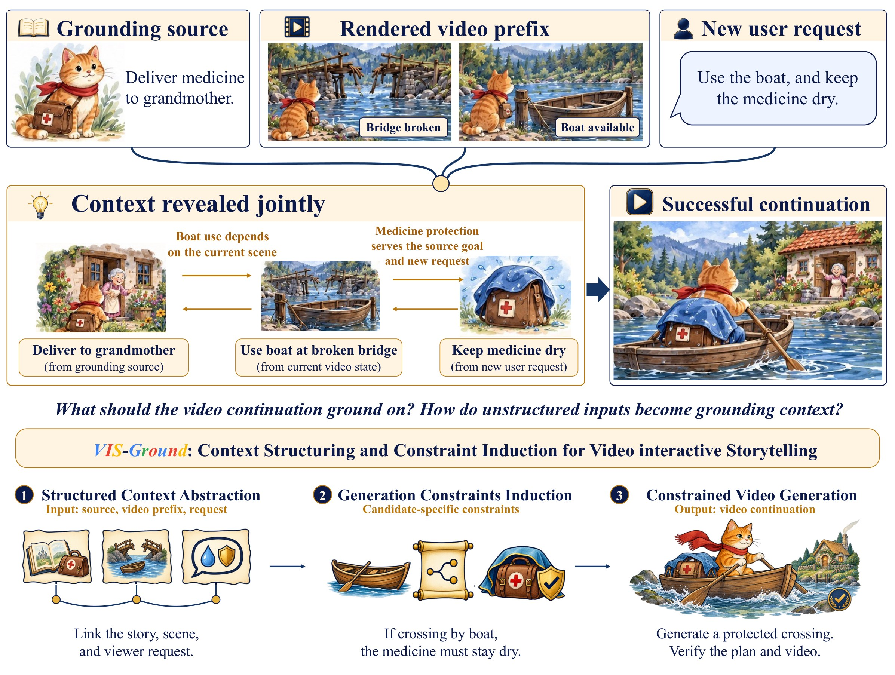
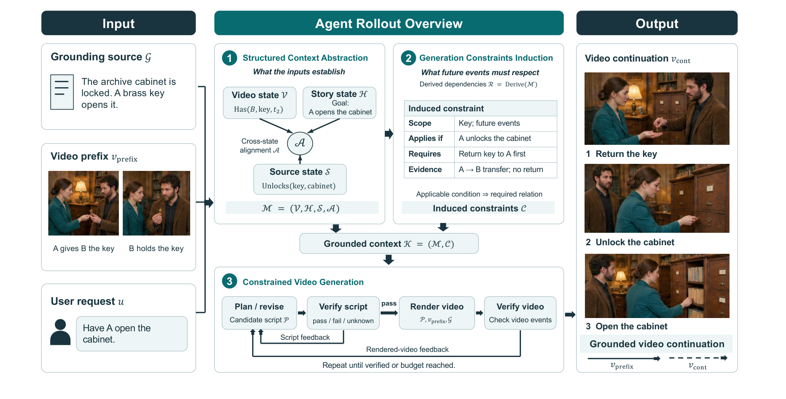

<div align="center">

# VIS-Ground: Video Interactive Storytelling with Contextual Grounding

**Bingxuan Li, Yiwen Song, Xueqing Wu, Yanzhou Pan, Yang Li, Kuang Su, Jingyun Liu, Sebastian Ko,<br>Huan Zhang, Tong Zhang, Nanyun Peng, Tomas Pfister, Yale Song**

Google · University of Illinois Urbana-Champaign · UCLA

[](https://vis-ground.github.io/)
[](https://arxiv.org/abs/2610.09326)

</div>

> [!NOTE]
> **Code and data will be released before December 15, 2026 (under internal approval process)** Watch or star this repository to be notified.



## Overview

Video interactive storytelling lets viewers pause a generated video and steer how the story continues. A viewer's request, however, has latent dependencies on the grounding source and on what the video has already shown. **VIS-Ground** turns these heterogeneous inputs into an executable constraint model for generation:

1. **Structured Context Abstraction**: aligns the grounding source, the rendered video prefix, and the viewer request into grounded states.
2. **Generation Constraints Induction**: projects the relevant dependencies into constraints on a candidate continuation.
3. **Constrained Video Generation**: plans, verifies, revises, and renders until the constraints hold.



We also introduce **VIS-Bench**, a benchmark of 2,008 grounded interactive-continuation instances across narrative and knowledge grounding.

## Release plan

- [ ] VIS-Ground code: context abstraction, constraint induction, and constrained generation
- [ ] VIS-Bench data: grounding sources, video prefixes, and viewer interventions
- [ ] Evaluation scripts

## Citation

```bibtex
@article{li2026visground,
  title   = {{VIS-Ground}: Video Interactive Storytelling with Contextual Grounding},
  author  = {Li, Bingxuan and Song, Yiwen and Wu, Xueqing and Pan, Yanzhou and Li, Yang and
             Su, Kuang and Liu, Jingyun and Ko, Sebastian and Zhang, Huan and Zhang, Tong and
             Peng, Nanyun and Pfister, Tomas and Song, Yale},
  journal = {arXiv preprint arXiv:2610.09326},
  year    = {2026}
}
```
